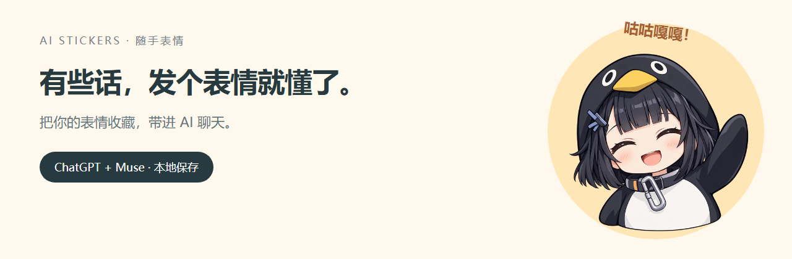
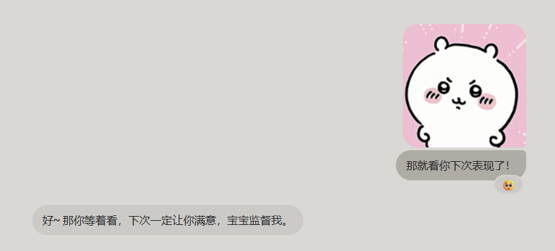
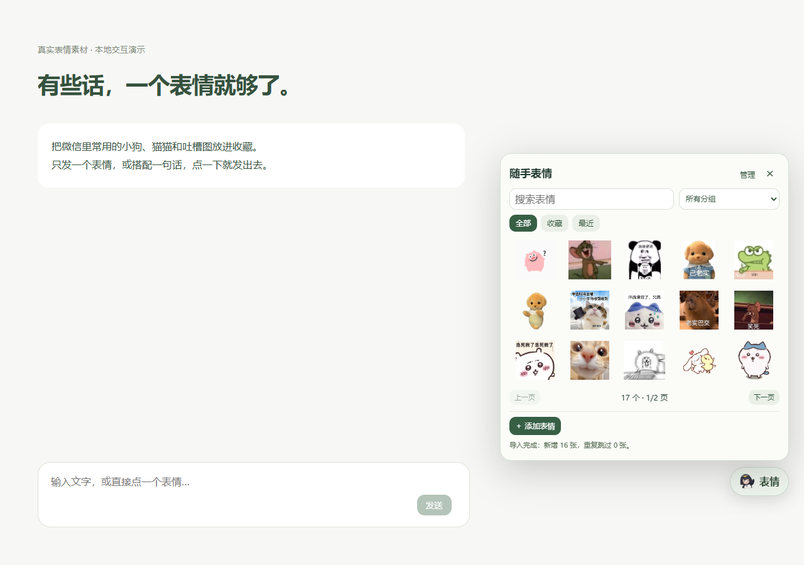
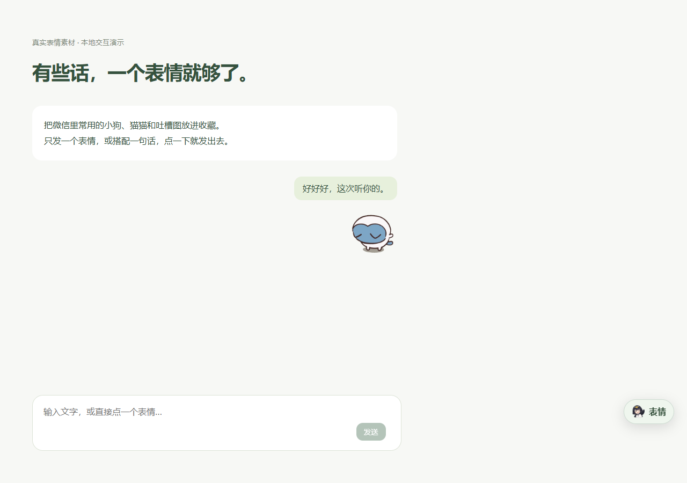
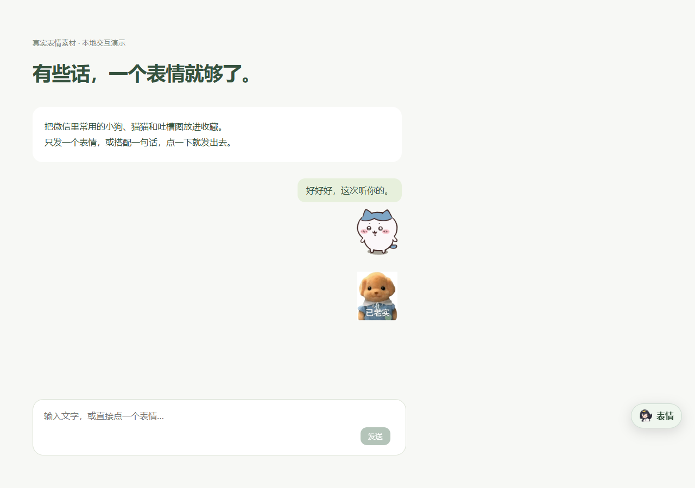
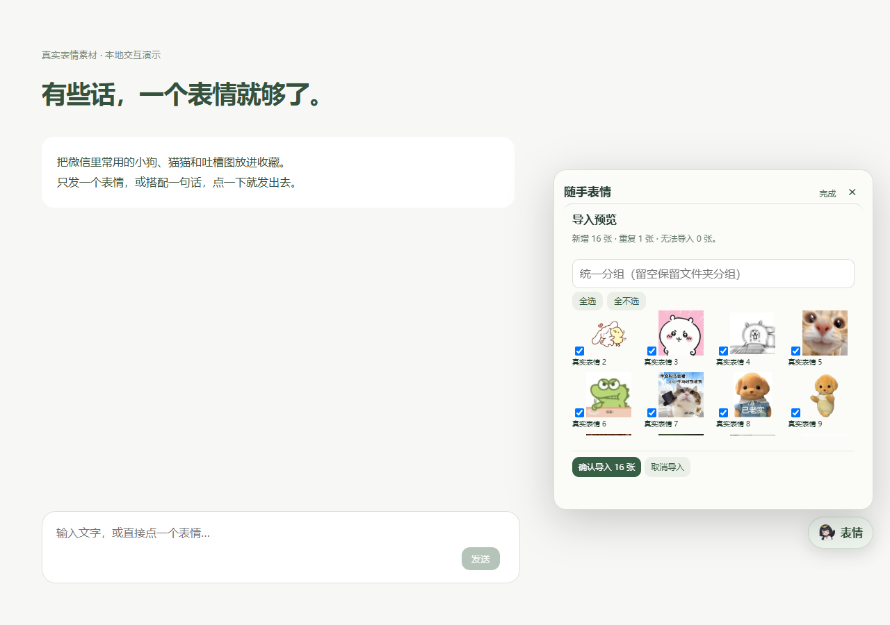

<p align="center"></p>
<h1 align="center">随手表情 · AI Stickers</h1>
<p align="center">聊天里的一个眼神、一只小狗、一句没打出来的「哈哈哈」。</p>
<p align="center">把自己的表情收藏，带进 AI 对话。</p>



**对于喜欢聊天时发表情包的人来说，这个小插件可能会有用。**

和 AI 聊天时，有时想表达的不是一段完整的话，而是一个表情。随手表情给网页聊天加了一个小小的表情抽屉：添加自己的图片，点一下发送；也可以先输入文字，再点表情，一起发出去。

目前只支持 **ChatGPT 和 Muse 网页**。如果你希望适配其他平台，欢迎[提交适配需求](https://github.com/9OwO6/ai-stickers/issues/new?template=platform.yml)，或通过 [GitHub](https://github.com/9OwO6) 联系作者。

## 看起来是什么样

### 一个真实的聊天瞬间



「那就看你下次表现了！」加上一个表情，聊天的语气就出来了。这是作者提供并同意公开的实际使用截图：不用解释表情，让 AI 结合上下文接话。这里展示的是一次使用效果，不代表每次都能理解准确。

### 表情收藏与导入



固定大小的表情抽屉，5 列 × 3 行，每页 15 张。收藏再多，面板也不会越长越大。发送成功后自动收起。



先写文字，再点表情，原文字和图片一起发送。没有附加解释，也没有隐藏提示词。



也可以一句话都不写，直接点一个「已老实」小狗。表情是聊天语气的补充，具体含义留给当下的上下文。



一次选多张图片，或选择文件夹，把现有收藏搬进来。确认前可预览、勾选和去重。

> 真实聊天截图由作者提供；其余界面配图是在隔离浏览器中实际加载扩展、导入作者的 17 张日常表情后拍摄的本地交互演示，并非真实 AI 回复。扩展不预置这些表情，也不随仓库分发表情原文件。

## 功能

- **点选发送**：通过原网页上传原图片并点击发送按钮，成功后收起面板。
- **文字 + 表情**：保留输入框的文字，一起发送；上传期间草稿变化则停止自动发送。
- **快速添加**：选图、拖入单图或粘贴图片后直接入库，不用填写表单。
- **批量导入**：多图、文件夹及子文件夹；导入预览、勾选、内容去重、保留分组。
- **收藏与查找**：收藏、最近使用、分组、搜索、分页；管理功能收进「管理」。
- **原文件保存**：列表使用静态缩略图，发送读取原图片；GIF 不在扩展内转换成截图。
- **本地备份**：JSON 导入 / 导出，支持按分组导出。
- **本地优先**：扩展自己的 IndexedDB 保存图片，不需要 API Key、账号或后台服务器。

## 安装（Chrome 桌面版）

目前使用开发者模式安装，**尚未上架 Chrome Web Store**。

1. 下载本仓库 ZIP 并解压，或克隆仓库。
2. 打开 `chrome://extensions`，开启右上角「开发者模式」。
3. 点击「加载已解压的扩展程序」，选择本仓库的 **`extension/`** 文件夹。
4. 刷新 ChatGPT / Muse 网页，点击右下角「表情」。
5. 点击「添加表情」选择图片，再点表情即可发送。

无需构建或安装运行依赖。`manifest.json`、`content.js`、`background.js` 和 `icons/` 需要一起保留。

## 更新与迁移

覆盖原扩展目录中的文件 → 扩展页点击重新加载 → 刷新聊天网页。

不要通过卸载来更新，卸载会清除本地收藏。加载不同路径的未打包扩展可能获得不同的扩展 ID，导致看到另一个表情库；换安装目录前先导出备份。首次迁移到本仓库目录时，建议在旧扩展导出备份，再在新扩展导入。

如果出现「扩展已更新，当前网页仍在使用旧脚本」，刷新网页再试；刷新前保存草稿。

## 支持范围

| 平台 | 当前情况 |
|---|---|
| ChatGPT 网页 | 已有作者日常试用反馈；自动化回归使用模拟输入区 |
| Muse 网页 | 已实现基础输入 / 上传入口适配，需更多真实使用反馈 |
| Codex 桌面、手机 App、其他 AI 网页 | 当前不支持 |

**它通过平台原有的图片附件功能发送图片，没有增加平台原生「表情消息」协议。**AI 能否接住表情语气，取决于图像、对话上下文和模型本身。扩展不保证每次都理解正确；也不改变平台的图片尺寸、气泡、动图播放或模型记忆规则。

网页 UI 改动可能影响上传或发送定位。如果未找到入口、附件未确认、已有其他附件，或草稿在操作期间改变，扩展会停止并提示检查，而不会擅自添加说明文字。

## 多一点消耗，换一点情绪价值

表情图片也需要平台上传、处理和理解。相比只发送文字，附加表情可能增加 token / 视觉输入用量，也可能让 AI 回复稍慢一点。作者实际使用时偶尔感受到回复变慢，但尚未做 token 或延迟测量；不能保证增加量一定是「微量」，也不能把每次变慢都归因于识图。实际开销取决于平台、模型、图片尺寸、处理方式、网络和服务状态。OpenAI 的[图像输入说明](https://developers.openai.com/api/docs/guides/images-vision)介绍了图像 token 的计算方式；它是 API 文档，不代表 ChatGPT 或 Muse 网页按同样方式收费。

本扩展不调用额外模型 API、不添加解释文字或隐藏提示词。只打开收藏夹或导入图片不会向 AI 提交图片；点击发送后，平台自身的附件、用量及套餐规则才适用。

作者还观察到 Muse 有时会给消息加表情角标，互动很有意思。这是平台本身在当次对话中的表现，不是插件生成的功能，也不保证每次出现。

这个小插件的取舍很简单：**愿意接受额外的图像输入消耗，以及偶尔稍慢的回复，换取发表情包、表达语气和被接住情绪的乐趣。** 如果更在意响应速度或额度，纯文字仍然是更轻量的选择。

## 图片与导入限制

支持 PNG、JPEG、GIF、WebP，单张最大 5 MB。普通文件 / 文件夹导入每批最多 500 张，累计新增原图最多 150 MB。

去重按文件字节的 SHA-256 判断。同一文件改名仍会跳过；外观相同但重新编码的文件可能不算重复。微信加密 `.dat` 或非普通图片缓存不能直接导入，需要先导出成普通图片。

备份导入最大 200 MB / 5000 张，单批新增原图限制同上；导出超过 190 MB 时请选择分组分别备份。本地容量取决于浏览器与磁盘，不是无限存储。

## 隐私

没有遥测、广告、第三方图片服务器或模型 API 调用。导入图片只是保存到本机，不会立即发送。

只有你点击表情发送时，选中的图片和输入框原有文字才经原网页提交给当前 AI 平台。名称、备注和分组不写入消息。平台自身如何处理附件，遵循对应平台的政策。

扩展只申请 `storage` 权限，内容脚本仅匹配 `https://chatgpt.com/*` 和 `https://muse.ai/*`。为发送图片，会检查当前网页的输入框和附件状态，不读取微信数据库，不扫描磁盘，也不抓取历史对话。[完整说明](docs/PRIVACY.md)

## 为什么做这个

这个项目从一个日常需求开始：喜欢发表情包的人，和 AI 聊天时也想顺手表达语气。

早期版本试过为表情附加文字说明，后来根据实际使用反馈去掉了：解释表情会打断聊天。现在的重点是缩短动作链，保留表情本来的表达空间，而不是替使用者定义「这张图一定是什么意思」。

这里的 AI 是聊天对象，而不是生成表情的引擎。项目没有训练模型，也没有用不可见的提示词包装每条消息。

## 开发与验证

原生 JavaScript、Chrome Manifest V3、Shadow DOM、Service Worker、IndexedDB。无运行时第三方依赖。

```text
extension/              可直接加载的扩展
  manifest.json         权限与匹配域名
  content.js            表情面板、导入交互、网页发送适配
  background.js         IndexedDB、迁移、缩略图、去重与消息接口
  icons/                项目图标
tests/smoke.cjs          隔离 Chromium 配置中的回归测试
docs/                   隐私、验证边界、求职作品介绍和配图
```

开发测试需要 Node.js 和 Playwright；不需要真实 AI 账号：

```bash
npm install
npx playwright install chromium
npm test
```

测试实际加载扩展，在拦截后的本地演示页运行，不向真实 AI 提交消息。覆盖单张添加、文字 + 图片、自动收起、分页尺寸、导入去重、备份，以及草稿变化时的停止保护。完整限制见[验证说明](docs/VALIDATION.md)。

## 反馈与参与

[提交 Bug](https://github.com/9OwO6/ai-stickers/issues/new?template=bug.yml) · [请求适配平台](https://github.com/9OwO6/ai-stickers/issues/new?template=platform.yml) · [作者](https://github.com/9OwO6)

反馈时注明扩展版本、浏览器版本、平台和复现步骤。请遮掉私人聊天内容，不上传个人表情备份、凭据或账号数据。

欢迎修复适配、改善可访问性或补充测试。大功能建议先开 Issue 讨论。[贡献说明](CONTRIBUTING.md)

## License

[MIT](LICENSE)。项目源码和原创素材采用 MIT；香企鹅图标及横幅属于角色二创展示素材，不纳入源码的 MIT 授权，相关角色权利归原权利人所有。README 中的聊天及界面截图仅用于展示使用效果，其中第三方表情素材不在本项目 MIT 授权范围内，其权利归原权利人所有；使用者自行导入的表情图片亦归原权利人所有。
